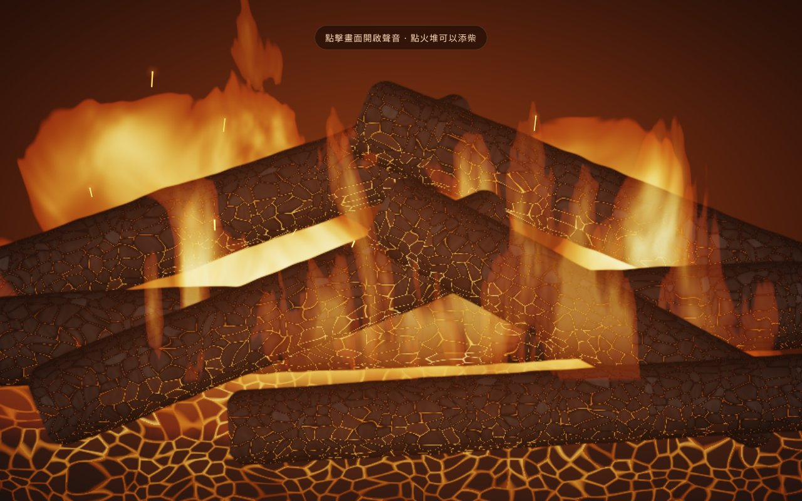

# 開發日誌

這個壁爐是在一個晚上（2026-11-03 凌晨）跟 Claude 對話做出來的。以下照順序記錄每一輪：引用區塊是我當時說的原話，後面是 Claude 做了什麼、遇到什麼問題、怎麼解決的摘要。我當時傳的參考照片不是我拍的，所以沒有放進來，只用文字描述。

---

## 1. 第一版：2D 壁爐 + WebGL 火焰

> 製作一個壁爐動畫網頁 會根據窗口大小調整畫面
> 而且畫面和音效都是即時運算讀到的

- 壁爐外觀（磚牆、壁爐台、爐床、木柴）用 2D Canvas 畫，依視窗大小重新計算版面
- 火焰用 WebGL 片段著色器，以 fbm 雜訊即時產生
- 火星粒子、炭火、木柴上發紅的裂紋、照亮房間的閃爍火光都是每格重畫
- 聲音用 Web Audio：濾波棕噪音當火焰呼嘯，每一聲爆裂都即時產生新的波形，並和火星粒子同步
- 第一次截圖發現火光過曝、磚牆太亮、窄螢幕上提示文字和控制列重疊，調整後發佈

→ [`versions/01-2d-procedural.html`](versions/01-2d-procedural.html)

## 2. 想要擬真

> （附上一張燃燒中木柴的特寫照片：炭化木頭表面有龜裂、縫隙透出橘紅光）
> 這種擬真風格做得到嗎

- Claude 分析照片寫實感的關鍵：炭化表面的龜裂、交錯堆疊的木柴、細長銳利的火舌、高對比的亮度
- 做了一個全畫面特寫：Voronoi 細胞雜訊做龜裂，多層扭曲雜訊做火舌，加上 HDR 色調映射
- 調了好幾輪：一開始整片過曝泛白、木柴像平板、火焰像一層霧蓋在木柴上

→ [`versions/02-realistic-closeup.html`](versions/02-realistic-closeup.html)

## 3. 要看得到壁爐

> 距離太近了 我是想要包含壁爐的

- 把擬真火堆的著色器搬回原本 2D 壁爐的爐膛裡，加上耐火磚後牆

## 4. 還是很假

> 感覺還是很假 怎麼辦

Claude 說明純程式運算要做到照片等級本來就很難（遊戲通常用實拍素材），並列出看起來假的原因：沒有光暈、火焰是實心的、木柴是平面的、畫面太乾淨。然後給了三條路：

1. 維持全即時運算，大幅升級成真正的 3D
2. 畫面改用實拍火焰影片
3. 混合

## 5. 走全即時運算的路

> 那就1好了 這是做好玩的 看你盡力能做到哪種程度

- 爐膛內改成 3D 光線步進：五根立體木柴（有鋸斷面年輪）、斜面側牆、耐火磚、炭床
- 體積火焰：沿視線在 3D 空間累積發光，會被木柴遮擋
- 火光照明與軟陰影
- 後製：多層光暈、ACES 色調映射、底片顆粒
- 爐口是固定的「窗口」，用離軸投影讓 3D 內部和 2D 外框對齊

→ [`versions/03-2d-frame-3d-firebox.html`](versions/03-2d-frame-3d-firebox.html)

## 6–7. 調整鏡頭

> 看起來還不錯
> 我想改變camera的位置 我要怎麼描述比較好

Claude 建議用「站在壁爐前的身體位置」來描述：高低、左右、遠近，並說明因為外框是 2D，鏡頭不能轉頭。

> 往左後站一點 往右下可以看到爐口 距離大概兩三步左右 算是站著看吧 爐口最高到身高三分之一左右 憑感覺講的

- 換算成場景座標：往左 0.55、高度 2.4、距離 2.1（單位是爐口寬）

## 8. 整個場景改成 3D

> （附上一張戶外柴爐的照片：從左前方略高的角度斜看，爐子方正、爐口寬扁）
> 我是想說整個壁爐嵌在牆裡 然後視角是類似我提供的圖片的角度

> 比例也是

- 2D 外框做不到斜看，所以整個場景改成全畫面 3D 光線步進：牆、凸出牆面的磚砌爐體、金屬爐框、石板爐床、木地板
- 房間只靠爐火照亮，火光從爐口打出去
- 火星改成 3D 粒子，會被爐口上緣遮擋，噴出來的會落到石板上
- 照第二句調成爐體方正、爐口寬扁，並讓壁爐佔滿大部分畫面

## 9. 擺設、柵欄、磚牆、頂燈

> 有喔 加點擺設 壁爐柵欄 希望整個牆面都是磚牆
> 希望相機頭上(大概右後上方)有個光源 但不用太亮

> 介面不用時希望自動隱藏 畫面上說明文字去掉

- 整面磚牆、木壁爐台、兩根蠟燭、花瓶、掛畫、地毯、備用柴、黑鐵柵欄（會投影）
- 鏡頭右後上方加一盞低亮度的暖白燈
- 拿掉說明文字，控制列 3 秒沒動就淡出

## 10. 色塊

> （附上截圖：爐體側面的磚牆有不規則的明暗色塊）
> 這種色塊感有辦法解決嗎

- 第一個原因：比一個像素還細的雜訊紋理，在低解析度下取樣不足，變成碎塊 → 依每個像素在該距離涵蓋的範圍，自動淡化太細的紋理
- 下一輪拿掉頂燈、畫面變暗後，才發現真正的主因：8-bit 中間畫面在暗部的階數不夠，RGB 各自跳階變成色斑 → 改用 gamma 編碼加抖動儲存

## 11. 精簡

> 蠟燭幫我拿掉好了 頂燈感覺加了沒差 也拿掉

> 柵欄高度幫我調低一半左右 然後希望有點圓弧形

- 柵欄改成往前凸的圓弧，用極座標寫距離場；火星撞到弧形柵欄會彈回

## 12. 九項新功能

> 讚喔 你還有甚麼建議嗎

Claude 提了九個方向：熱氣扭曲、煙、月光冷暖對比、時間累積畫質、火會燒完、鏡頭晃動、房間殘響與雨聲、睡眠計時、畫質選項。

> 完了 你講的這些我都想做
> 燒完這點我在想能不能把做成可以開關的選項

- 全部做進去，「自然燃燒」做成開關：開啟後約 12 分鐘燒完，木柴變細、變灰，添柴時新木柴會從上方掉進火堆，帶著樹皮慢慢燒黑
- 設定面板：畫質、自然燃燒、鏡頭晃動、雨聲、睡眠計時

## 13. 當機與白屏

> windows 的 edge和claude app會直接死掉 要用工作管理員重開(RTX 3060 12G)
> android上用claude app和用chrome看以及macos上用claude app都是一片白畫面 但聲音是正常的
> (mac mini M4, asus zenfone 10)

這是整個過程最大的坑，Claude 的測試環境是軟體繪圖，兩個問題都沒測出來：

- **Windows 當掉**：房間打光函式在著色器裡被展開 14 次，每次又包著兩組陰影迴圈。Windows 上 ANGLE 把 GLSL 轉成 HLSL，DirectX 編譯器會把迴圈全部攤平，程式碼爆量，編譯時把顯示卡程序卡死。
  - 改用 WebGL2，迴圈從一個值為 0 的 uniform 開始，編譯器沒辦法攤平
  - 重構成「材質函式只回傳顏色，最後統一打一次光」，讓陰影只出現在一個呼叫點
  - 著色器改用 `KHR_parallel_shader_compile` 在背景編譯；顯示卡被重置時顯示提示
- **白屏**：這些平台支援浮點中間畫面，存得下負數，抖動產生的微小負值取次方後變成 NaN，被時間累積和光暈擴散到全畫面。所有中間值都夾在合理範圍內，最後再過濾一次 NaN。

> 都正常了 幫我更新公開的版本吧

## 14. 放上 GitHub

> 有點想公開丟到github
> 對話過程也是

就是這個 repo。

## 15. 整理程式碼

> 有可能整理你目前的程式嗎 拆成多個檔案之類的 其實我沒強求你寫成一個檔案 看你要不要記住

- 原本為了能直接發佈成單一網頁，所有東西都塞在一個 HTML 裡；這次拆成 10 個 JS 模組、13 個著色器檔案和一個 CSS
- 場景著色器依功能拆成七段（uniform、雜訊、幾何、打光、材質、火焰、主程式），用 clang-format 排版
- 寫了一個不需要安裝任何套件的打包腳本，把它們組回單一 HTML（`dist/fireplace.html`），讓直接下載、雙擊開啟的用法繼續可用
- 行為和畫面都跟拆分前一致

## 16. 壁燈

> 感覺還是要有個類似燈的光源 不然牆面都好暗

- 之前那盞看不見的頂燈效果不明顯，這次改成壁爐兩側磚牆上看得見的壁燈：古銅燈座、上窄下寬的亞麻燈罩
- 燈罩上下開口，光主要往上、往下打在牆上，形成扇形光暈；燈罩本身從內透出暖光
- 設定面板新增「壁燈」開關（開關時亮度漸變），睡眠計時淡出時壁燈也會跟著調暗
- 壁燈的光沒有算陰影，打光仍然集中在 `lightRoom()` 一個地方，維持 Windows 上不會爆量的結構
