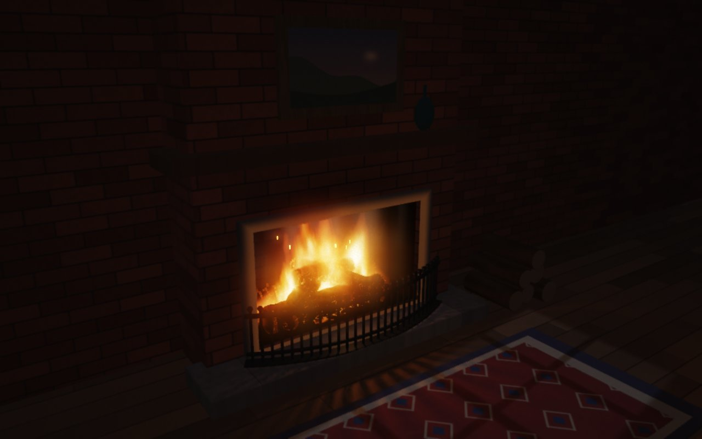
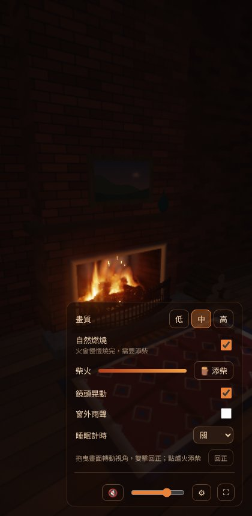
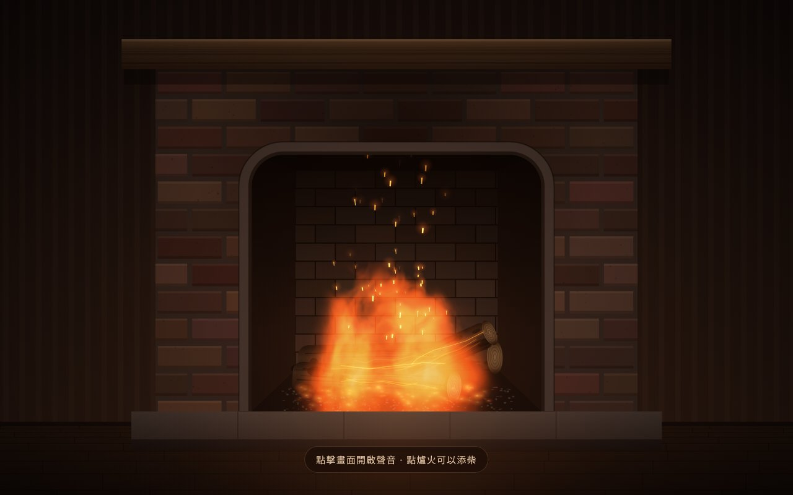
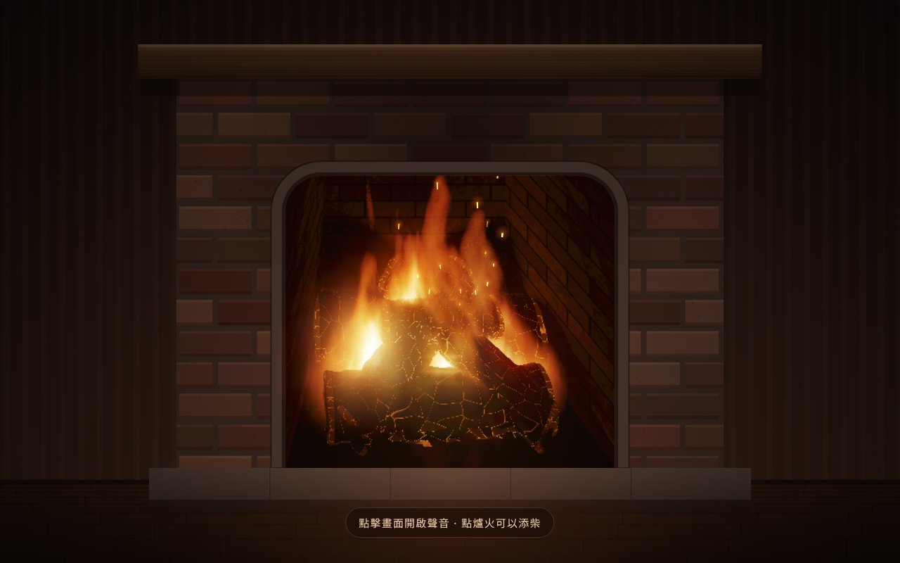

# 🔥 壁爐 Fireplace

一個完全**即時運算**的 3D 壁爐網頁：畫面用 WebGL2 光線步進（raymarching）每一格算出來，聲音用 Web Audio API 即時合成。沒有任何圖片、影片或音檔素材，整個作品就是一個 HTML 檔。

**線上體驗**：<https://claude.ai/artifact/4tpBBE29PYUFZQW3H1rVJS>
（也可以直接下載 `index.html` 用瀏覽器打開）

## 特色

**畫面**
- 嵌在磚牆裡的壁爐、木壁爐台、掛畫、花瓶、弧形鐵柵欄、地毯、備用柴，全部用距離場（SDF）描述，光線步進渲染
- 體積火焰：在 3D 空間沿視線累積發光，火舌會被木柴遮擋、從縫隙竄出
- 炭化木柴表面用 Voronoi 細胞雜訊做出「鱷魚皮」龜裂，裂縫依溫度發光閃爍
- 火光即時照亮房間，木柴、柵欄投下會晃動的軟陰影
- 煙、熱氣扭曲、窗外月光的窗格影子（冷暖對比）
- 後製：多層光暈、ACES 色調映射、時間累積抗鋸齒、底片顆粒
- 任何視窗比例都會自動調整取景

**聲音**（全部即時合成）
- 火焰呼嘯（濾波棕噪音，跟火勢同步）
- 每一聲木柴爆裂都是當下產生的新波形，和畫面上的火星同步
- 房間殘響（程式產生的脈衝響應）
- 窗外雨聲（可開關）

**互動**
- 點爐火：添柴／讓火變旺
- 拖曳畫面：轉動視角；雙擊回正
- ⚙ 設定面板：
  - 畫質（低／中／高）
  - 自然燃燒：火會在約 12 分鐘內慢慢燒完，木柴變細、變灰，需要添柴；新木柴會從上方掉進火堆
  - 鏡頭晃動
  - 窗外雨聲
  - 睡眠計時（15／30／60／90 分鐘後，火和聲音一起淡出）

## 系統需求

需要支援 **WebGL2** 的瀏覽器。著色器運算量不小，獨立顯示卡或 Apple Silicon 會比較順；網頁會依實際流暢度自動調整解析度，也可以在設定裡手動選低畫質。

已測試：Windows（Edge、RTX 3060）、macOS（Mac mini M4）、Android（Zenfone 10，Chrome）。

## 演進過程

這個作品是跟 Claude 一來一往做出來的，完整過程寫在 [DEVLOG.md](DEVLOG.md)。`versions/` 資料夾保留了幾個中間版本：

| 版本 | 說明 |
|---|---|
| [`01-2d-procedural.html`](versions/01-2d-procedural.html) | 第一版：2D Canvas 畫壁爐，WebGL 著色器畫火焰 |
| [`02-realistic-closeup.html`](versions/02-realistic-closeup.html) | 擬真特寫實驗：只有火堆，沒有壁爐（後來沒採用） |
| [`03-2d-frame-3d-firebox.html`](versions/03-2d-frame-3d-firebox.html) | 2D 外框 + 透過爐口看進去的 3D 光線步進火堆 |
| [`index.html`](index.html) | 最終版：整個場景全 3D |

舊版本保留原樣，沒有套用後來的相容性修正，在部分裝置上可能跑不順。

| 01 | 03 | 最終版 |
|---|---|---|
|  |  |  |

## 技術筆記

幾個踩過的坑，記下來給有興趣的人：

- **Windows 上整個瀏覽器當掉**：Windows 的瀏覽器透過 ANGLE 把 GLSL 轉成 HLSL，再交給 DirectX 編譯，而 DirectX 會把迴圈全部攤平展開。如果著色器裡同一個含迴圈的函式（例如陰影）被呼叫很多次，程式碼會爆量，編譯時把顯示卡程序卡死。解法是改用 WebGL2，用一個值為 0 的 uniform 當迴圈起點，讓編譯器沒辦法攤平；同時重構成「先決定材質，最後只打一次光」，讓昂貴的函式在程式碼裡只出現一次。
- **Mac／Android 一片白**：中間畫面用 16-bit 浮點時可以存負數，抖動產生的微小負值取次方後變成 NaN，再被時間累積和光暈擴散到全畫面。所有中間值都要夾在合理範圍內。
- **暗部色塊**：8-bit 中間畫面在暗部的階數太少，RGB 各自跳階就變成色斑；改用 gamma 編碼加抖動儲存，或直接用浮點緩衝。
- **細紋理閃爍**：依每個像素在該距離的涵蓋範圍，自動淡化太細的雜訊（類似 mipmap 的概念）。

## 授權

[MIT](LICENSE)
